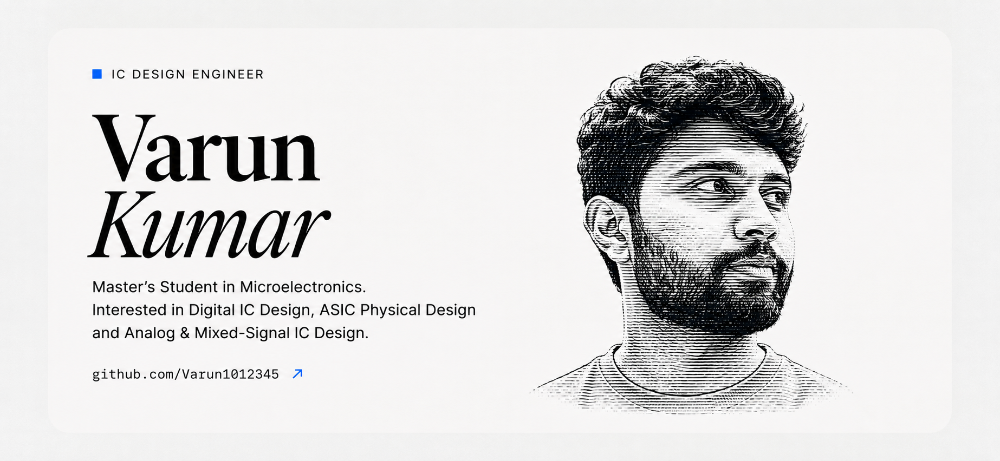

  

 

<h2 align="center">👨‍💻 About Me</h2>

- 🎓 Master's student in Microelectronics.
- 🔧 Interested in Digital IC Design and ASIC Physical Design.
- 💻 Working on an RV32I RISC-V processor using Verilog.
- 📡 Exploring Analog and Mixed-Signal IC Design.
- 🚀 Building skills in RTL Design, Verification, and Semiconductor Technologies.
- 

<h2 align="center">🛠️ Technical Skills</h2>

<h3 align="center">Programming & Hardware Description</h3>

  
  
  

<h3 align="center">Tools & EDA</h3>

  
  
  

<h3 align="center">Areas of Interest</h3>

  
  
  
  

<h2 align="center">🚀 Featured Projects</h2>

<h3>1. RV32I Single-Cycle RISC-V Processor</h3>

- Designed a single-cycle RISC-V processor using Verilog.
- Implemented ALU, Control Unit, Register File, Immediate Generator and Memory modules.
- Implemented and tested arithmetic, memory and control-flow instructions.
- Verified functionality using ModelSim.

<h3>2. Second-Order Switched-Capacitor Delta-Sigma ADC</h3>

- Working on a second-order switched-capacitor Delta-Sigma ADC.
- Exploring behavioral modelling and circuit-level implementation.
- Targeting a 1 kHz bandwidth and 100 dB SNR.
- Exploring analog/mixed-signal IC design using the IHP130 technology.
- 

<h2 align="center">📊 GitHub Statistics</h2>

  
  

  

  

<h2 align="center">🤝 Connect With Me</h2>

  
  

  Interested in connecting with people working in IC Design, ASIC Design and Semiconductor Technologies.

